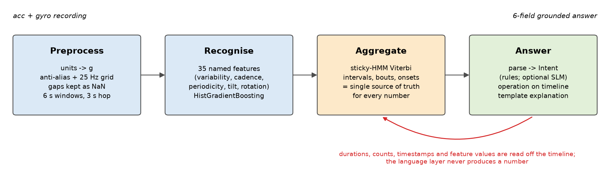
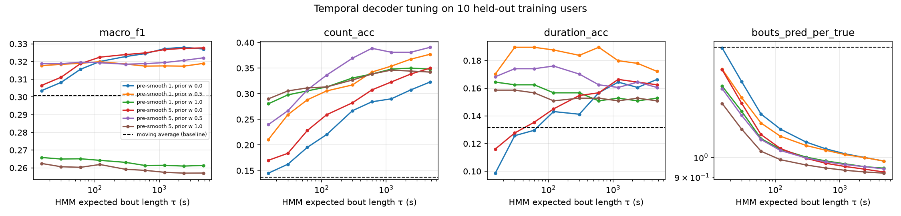
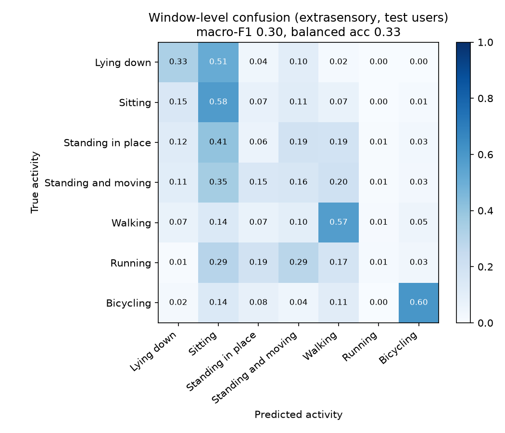
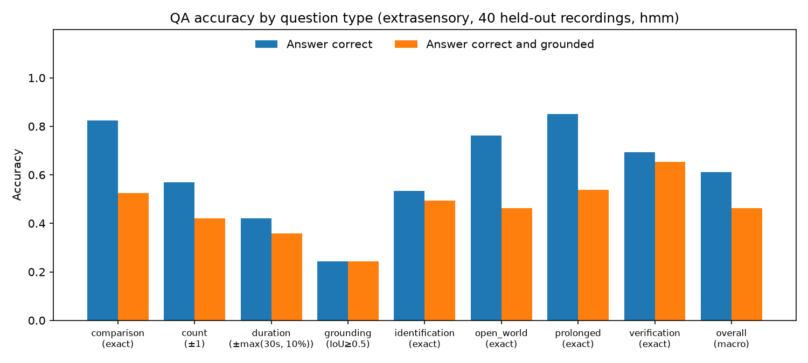
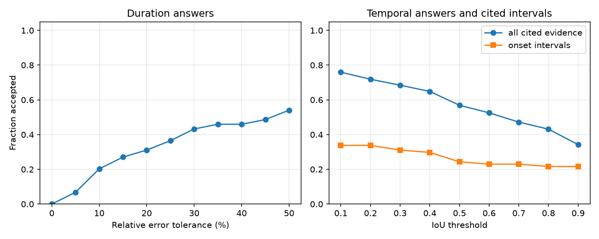
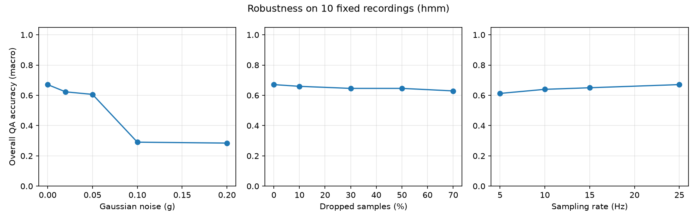
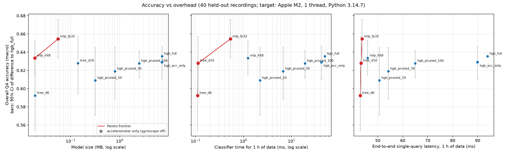

# Abstract

We present a system that answers natural-language questions about a person's physical activity
from raw accelerometer and gyroscope recordings, and supports every answer with evidence: the
timestamps it relied on, the sensor modality and channels, and an explanation built from measured
signal properties. The system is layered. Signals are cleaned, resampled to 25 Hz and cut into
6 s windows. A class-balanced gradient-boosted classifier labels each window from 35 named
physical features. A sticky hidden Markov model decodes the window probabilities into an activity
timeline. A small language model, Qwen3-1.7B quantised to 4 bits and run locally with llama.cpp,
reads each question into a schema-constrained intent; Python executes it as operations on the
timeline, and the model then words the explanation. The central design rule is that **the language
layer never produces a number**: every duration, count, timestamp and feature value in an answer is
computed from the timeline, and a model-worded explanation is discarded if it contains a number the
pipeline did not compute. On 767 questions over 40 recordings of 12 held-out ExtraSensory users the
system answers 61.2% correctly (macro-average over eight question types) and 46.2% correctly *with*
correct evidence, against 63.6% and 47.5% for a hand-tuned rule parser that we built first and keep
as a baseline. Temporal decoding raised the rule-parser figures from 55.3% and 38.1%. On unseen
hand-written questions the language model reaches 82% intent accuracy (rules: 96%), at about 2 s per
question on a laptop. For the efficiency extra credit, a distilled, 8-bit quantised MLP is 380×
smaller than the full model (19 KB vs 7.3 MB) and 40× faster in classification, with no measurable
loss of QA accuracy (paired 95% CI of the difference −0.020 to +0.017).

# 1. Problem framing

The task is question answering over a sensor stream rather than over text. A question such as
"When did the user start running?" has an answer that is a number, an interval, a label or a
verdict, and the brief requires that it be *grounded*: the answer must name the time range and the
sensor channels it rests on, and explain how the signal supports it. Grading is on hidden
recordings and hidden questions, so the system must generalise across users, devices and phrasings.

We frame the problem as four sub-problems, matching the four tiers of the brief:

1. **Recognition** (tier 1): which of seven activities — lying down, sitting, standing in place,
   standing and moving, walking, running, bicycling — happens in each short stretch of signal.
2. **Temporal and quantitative reasoning** (tier 2): durations, counts, comparisons, longest bouts
   and prolonged periods over a whole recording. These depend less on per-window accuracy than on
   whether the recognised timeline has the right *structure*.
3. **Evidence grounding** (tier 3): onsets and cited intervals, scored by temporal overlap.
4. **Open-world reasoning** (tier 4): judgements beyond the seven labels — exercise, sleep,
   commuting, chores, falls — argued from activity patterns and signal properties.

Two consequences shaped the design. First, numbers produced by a language model cannot be trusted
to match the signal, so all quantitative content must come from a deterministic structure; a
language model may read the question and word the explanation, but not compute. Second,
a question about a whole recording aggregates hundreds of window decisions, so errors that are
harmless per window (an isolated misclassification) become severe after aggregation (a spurious
extra bout). Section 3.4 shows this effect is the main lever for tier-2 accuracy.

# 2. Data and evaluation protocol

## 2.1 ExtraSensory subset

We use the ExtraSensory dataset (Vaizman et al., 2017): 60 users who carried their own phones in
daily life. For each minute the app recorded about 20 s of raw accelerometer and processed
gyroscope samples, and users self-reported context labels. We keep the accelerometer and gyroscope
only, map the seven `original_label` columns to our classes, and keep minutes with exactly one of
the seven labels. Working with the raw files exposed several data problems that the loader now
handles:

- **Units differ by phone**: iPhones report g, Android phones m/s². Units are decided once per
  recording from the median magnitude (a per-minute decision mis-scaled some bursts).
- **Sampling rates differ**: most phones sample at ~40 Hz, some Android phones at 100–200 Hz.
  A box anti-aliasing filter is applied before interpolation when the source rate exceeds 50 Hz.
- **Glitched timestamps**: some bursts contain a sample whose clock jumps by ~1.8 million seconds
  and back. Left in, one 130-minute session stretched to 498 h and exhausted memory. Samples more
  than 60 s from the burst's median time are dropped.
- **A faulty sensor**: one phone's per-burst median |acc| swings between 0.03 and 1.4 g. Users whose
  10–90th percentile spread exceeds 0.5 g are excluded (1 of 60).
- **Missing gyroscope**: 3 of 60 users have no gyroscope; 94% of training windows have one.

Labels are self-reported and cover the whole minute, while the phone may be on a table during the
recorded burst. Of the training windows labelled walking, running or bicycling, 22% show
essentially no motion (accelerometer-magnitude variability below 0.01 g).

## 2.2 Split and windows

Users are split once, with a fixed seed, into 47 training and 12 test users (stored in
`configs/split.json`; no user appears in both). Recordings are runs of minutes with gaps of at most
5 minutes, cut into pieces of at most 12 hours. After windowing (6 s windows, 3 s hop, at least 60%
of samples present) there are 1.40 M labelled training windows and 325 k test windows.

| Class | Training windows | Share | Test windows |
|---|---:|---:|---:|
| Lying down | 501,636 | 35.9% | 90,605 |
| Sitting | 598,984 | 42.8% | 164,166 |
| Standing in place | 35,318 | 2.5% | 9,402 |
| Standing and moving | 140,796 | 10.1% | 24,620 |
| Walking | 92,312 | 6.6% | 30,659 |
| Running | 6,356 | 0.5% | 1,087 |
| Bicycling | 23,475 | 1.7% | 4,279 |

: Labelled windows per class. The imbalance spans two orders of magnitude.

## 2.3 Question sets and scoring

The evaluation questions are hidden, so we built two complementary question sets.

**Generated QA set (end-to-end).** For each held-out recording, `eval/questions.py` generates
questions of eight types from the ground-truth labels: identification, verification, duration,
count, comparison, onset ("grounding"), prolonged and open-world. The reference answer is obtained
by running *the same operation* on a timeline built from the ground-truth labels, with the intent
constructed directly rather than parsed. This makes definitions (what a "bout" is, what "prolonged"
means) identical between system and reference, and tests recognition, aggregation and parsing
together. The fixed set has 767 questions over 40 recordings of the 12 test users; question
sampling is seeded per recording, so every configuration answers exactly the same questions.

**Hand-written parser sets.** Generated questions use a handful of templates, which says little
about unseen phrasing. We wrote 105 questions annotated with the intent they should produce
(operation, activity groups, time range), covering paraphrases, synonyms, number words, clock and
day-period times, typos, unsupported quantities and open-world cues. They were split *before* any
parser work into a development set (55 questions, used to improve the parsers and the prompt) and
a test set (50, only scored).

**Correctness rules.** Following the brief, each answer type has its own rule, and overall QA
accuracy is the fraction correct per type, macro-averaged over types:

| Type | Rule |
|---|---|
| Identification, verification, comparison, prolonged, open-world | exact match |
| Duration | absolute error ≤ max(30 s, 10% of the reference) |
| Count | absolute error ≤ 1 |
| Onset (grounding) | yes/no matches, and when yes, IoU of cited and reference interval ≥ 0.5 |
| *Grounded and correct* | answer correct **and** cited-interval IoU ≥ 0.5 **and** modality matches |

: Scoring rules. The last row is the stricter "with evidence" score.

Beside these accuracies we report the per-kind metrics the brief asks for (Section 5.2): precision,
recall, F1 and specificity for yes/no answers; macro-F1 and balanced accuracy for categorical
answers; mean and median absolute error for durations and counts; and grounding precision, the
share of cited time that the ground-truth labels confirm. Explanations are graded separately with a
fixed 1–5 rubric (Section 5.7).

# 3. System design

{width=90%}

## 3.1 Preprocessing

Each recording is placed on a single 25 Hz grid (the common time base the brief requires). Samples
are interpolated linearly; grid points farther than 0.2 s from a real sample stay missing (NaN)
instead of being invented, so ExtraSensory's 40 s gaps between bursts remain gaps. Windows are 6 s
(150 samples, at least six gait cycles at 1 Hz) with a 3 s hop; a window is kept if at least 60%
of its accelerometer samples are real, and small holes inside a kept window are interpolated.
Gyroscope channels stay NaN when the phone has no gyroscope.

## 3.2 Features

We extract 35 features per window, each with a physical meaning: per-axis mean and standard
deviation; device tilt relative to gravity on each axis; accelerometer-magnitude mean, variability,
percentiles, range, peak and jerk; dominant frequency and periodicity in the 0.5–6 Hz gait band;
autocorrelation peak; low- and high-band energy ratios; inter-axis correlations; and gyroscope
magnitude mean, variability, peak, dominant frequency and periodicity. Engineered features were
chosen over a learned representation because the *same numbers* are quoted back in the
explanations ("a regular rhythm at 2.1 Hz, about 128 steps per minute"), which ties every
explanation to the signal by construction.

## 3.3 Recognition backbone

A `HistGradientBoostingClassifier` (300 rounds, 31 leaves, learning rate 0.08) labels each window.
It is small, fast on a CPU, handles missing gyroscope values natively, and supports class
weighting. The training recipe addresses the data problems of Section 2:

- **Class-balanced weights** and a **cap of 3,000 windows per user and class**, so two heavy-sitting
  users cannot dominate.
- **Gyroscope dropout**: gyroscope features are blanked on 20% of training windows, so the model
  also learns an accelerometer-only path. Without it a no-gyroscope user was never recognised as
  running in our synthetic checks.
- **Label cleaning (training only)**: walking/running/bicycling windows with no motion are dropped
  from training; test labels are never touched.

## 3.4 Timeline: sticky-HMM temporal decoding

The timeline turns per-window probabilities into intervals and is the single source of truth for
every temporal answer. Our first version took the arg-max of a 5-window moving average of the
probabilities. It recognised windows reasonably but **fragmented** the timeline: across a 12-hour
recording, isolated misclassifications split long bouts, so a user with 3 sitting bouts was
reported with 37. Count, duration and onset accuracy suffered (0.37, 0.29 and 0.15).

We therefore decode the activity sequence with a sticky hidden Markov model and the Viterbi
algorithm. The emission score of class *c* in window *t* is
log *p*(c | x~t~) + λ log π~c~, where *p* is the (5-window smoothed) classifier output, π is the
class prior and λ = 0.5. Because the classifier is trained with balanced class weights its outputs
behave like scaled likelihoods, so the prior is added back explicitly. Between windows Δt seconds
apart the activity persists with probability exp(−Δt/τ) and otherwise switches to one of the other
six classes with equal probability. τ is the expected bout length, and a longer data gap makes a
change more plausible. Decoding runs independently on each stretch of data separated by gaps too
long to bridge (> 48 s).

The three parameters were tuned on 10 users held out *from the training users* with a validation
model trained on the other 37; test users were never used. The objective averaged window macro-F1
and two QA proxies (per-activity count within ±1 and total duration within tolerance). Settings
from τ = 600 s to 4,800 s form a flat optimum (objective 0.290–0.291); we chose τ = 600 s, an
interior and physically plausible value. On the validation users the predicted number of bouts per
true bout fell from 1.80 to 0.98, and count accuracy rose from 0.14 to 0.39.

{width=72%}

After decoding, consecutive same-label windows are merged into intervals, gaps up to 45 s are
bridged (ExtraSensory's normal gap between bursts is ~40 s), intervals shorter than 9 s between two
touching intervals of the same activity are absorbed, a *bout* must last at least 10 s, and
*prolonged* means a bout of at least 600 s.

## 3.5 Question understanding

A question is parsed into an `Intent`: an operation (identify, verify, duration, count, onset,
compare, longest, prolonged, open), a list of activity groups and an optional time range. Activity
groups let one word stand for several classes ("standing" covers both standing classes, "resting"
covers lying, sitting and standing in place, "on foot" covers walking and running).

**Language-model parser (the system).** Qwen3-1.7B, quantised to 4 bits (Q4_K_M GGUF, 1.0 GB), runs
locally through llama.cpp (Metal GPU, thinking mode off, greedy decoding). A fixed prompt with 22
worked examples, unlike the evaluation phrasings, asks for a JSON object: the operation, the
activity groups, the time expression *as written* (kind — between, after, before, first, last, at,
clock, day period — with its numbers, unit, clock time or period) and, for open-world questions, the
topic (e.g. exercise, sleep, heart rate). llama.cpp compiles the JSON schema into a grammar, so the
output is always well-formed and names only known operations and classes. Python converts the time
expression into seconds from the recording start; the model does no arithmetic. A day period or
clock time absent from the question is dropped, and a comparison with one activity is answered as
that activity's duration. Qwen3-0.6B (378 MB) can be chosen for speed.

**Rule parser (baseline).** A deterministic parser built first (spoken-form normalisation, typo
correction, time patterns, ordered operation patterns; 0.3 ms per question) is kept as a baseline
and used where an experiment should isolate the sensor pipeline (Sections 5.3, 5.4 and 6).

## 3.6 Operations and the grounding rule

Each operation reads the timeline and fills the six required output fields:

| Operation | Answer | Evidence cited |
|---|---|---|
| identify | activity with the most time in the range | its longest intervals in the range |
| verify | Yes / Likely yes / No | the matching bouts; for "No", the dominant activity instead |
| duration | total seconds | every contributing interval |
| count | number of bouts ≥ 10 s | the bouts |
| onset | "Yes, X began at t s" | the first bout, contrasted with the preceding interval |
| compare | the activity with more (or less) time | both totals |
| longest | length and span of the longest bout | that bout |
| prolonged | Yes/No against the 600 s threshold | the longest bout |
| open | verdict (Consistent / Partially / Not consistent) | intervals of supporting activities |

: Operations. All numbers are read off the timeline.

The modality field is "Accelerometer, Gyroscope" when the recording has a gyroscope and
"Accelerometer" otherwise. Explanations are templates filled with the mean feature values of the
cited windows, contrasted with the rest of the recording, for example: *"The cited windows show
accelerometer magnitude variability of 0.193 g, a regular rhythm at 2.14 Hz (about 128 cycles/min,
periodicity 0.39), gyroscope rotation averaging 0.97 rad/s … For contrast, the rest of the recording
averages 0.062 g variability."* A "Yes" whose supporting intervals have a mean probability below 0.6
is hedged as "Likely yes", and a "No" is still grounded by citing what the user was doing instead.
The language model then rewords this template in plain sentences from the computed fields only;
its text is kept only if every number in it appears in those fields (otherwise the template is used:
14 of 670 explanations), and "N/A" answers are never reworded.

## 3.7 Open-world reasoning

Each behaviour outside the seven labels is described by the recognised activities that would
support it and a signal property it requires: exercise needs running, cycling or walking at
moderate-to-vigorous intensity; commuting needs sustained walking or cycling bouts (≥ 5 min);
sleeping needs lying down with almost no motion; desk work needs still sitting; chores and shopping
need light standing-and-moving and walking. The verdict follows from the share of analysed time
that meets both conditions (≥ 50% consistent, ≥ 15% partially), and the explanation states that
share, the intensity and the longest bout. Falls are handled separately: a fall needs an impact
(peak > 2 g with jerk far above the recording's typical level) **followed by** a fall signature —
stillness (< 0.03 g variability) or a device-orientation change above 45° within the next minute.
Impacts during continuing movement with unchanged orientation are reported as likely footstrikes
or bumps, with their timestamps, rather than as falls.

# 4. Implementation and reproducibility

The code is a Python package (`src/ats/`) with one module per layer, plus scripts:

| Step | Command | Output |
|---|---|---|
| Download raw data (~16 GB zipped) | `scripts/download_data.py` | `data/raw/` (never committed) |
| Window features per user | `scripts/build_dataset.py` | `data/processed/` |
| Train, Figure 2 | `scripts/train.py` | `models/hgb_full.joblib` |
| Tune the decoder (optional) | `scripts/tune_smoothing.py` | tuning table and figure |
| QA evaluation, Figures 1, 3, 5 | `scripts/evaluate.py --robustness` | metrics, records, figures |
| Efficiency, Figure 4 | `scripts/benchmark.py` | `efficiency.json`, figure |
| Parser evaluation | `scripts/eval_parser.py` | intent accuracy per set |
| Explanation rubric | `scripts/grade_explanations.py sheet` / `agree` | grading sheets, agreement |
| Answer questions | `scripts/answer.py --recording r.csv --questions q.txt [--slm Qwen3-0.6B]` | 6-field answers |
| Web page | `streamlit run app.py` | upload, choose model, ask |

All randomness is seeded: the user split is stored in `configs/split.json`, question sampling is
seeded by a CRC32 hash of the recording id (Python's `hash()` is salted per process), and models use
fixed random states. A test suite of 25 checks (`pytest`) exercises every layer on synthetic
signals, which are used only for testing and never reported as results. The runnable system reads
any CSV with a time column and accelerometer (optionally gyroscope) columns, with loose column-name
matching; a 4.4-hour recording is processed in under 1 s, after which each question takes 2–5 s,
almost all of it the language model. A Streamlit page (`app.py`) offers the same pipeline: upload one
or more recordings, choose Qwen3-1.7B or Qwen3-0.6B, ask a question and read the six-field answer
with the recognised activity timeline.

# 5. Results

## 5.1 Recognition backbone

{width=44%}

| Class | Precision | Recall | F1 |
|---|---:|---:|---:|
| Lying down | 0.49 | 0.33 | 0.40 |
| Sitting | 0.60 | 0.58 | 0.59 |
| Standing in place | 0.03 | 0.06 | 0.04 |
| Standing and moving | 0.10 | 0.16 | 0.13 |
| Walking | 0.47 | 0.57 | 0.52 |
| Running | 0.01 | 0.01 | 0.01 |
| Bicycling | 0.34 | 0.60 | 0.43 |

: Per-class window metrics on test users. Macro-F1 0.30 raw, 0.38 after HMM decoding; balanced accuracy 0.33 raw, 0.36 decoded.

Window-level accuracy is modest, and the confusion matrix shows why. (i) **Lying versus sitting**:
both are still, so they are told apart only by phone orientation, which depends on where the phone
is (pocket, bag, table); 43% of lying windows are predicted as sitting. (ii) **Label noise**: 816 of
the 1,087 test windows labelled running come from one user whose phone was essentially motionless
(median variability 0.002 g) during those minutes, so no motion-based model can recognise them.
Restricted to windows where the phone actually moves (variability ≥ 0.05 g), walking recall is
0.81 and bicycling 0.83. (iii) **Running versus walking**: even on moving windows only 6% of
running is recognised; 76% is called walking, as a phone in a bag does not show the larger impacts
a body-worn sensor would. Vaizman et al. score each label one-vs-rest and fuse more sensors
(watch, audio, location), so their figures are not directly comparable with a 7-way choice from
phone motion alone. For reference, our one-vs-rest balanced accuracies are 0.79 (bicycling), 0.75
(walking), 0.59–0.60 (sitting, lying) and 0.50–0.52 (standing in place, standing and moving,
running).

## 5.2 Question answering

{width=68%}

| Question type | Rules, MA | Rules, HMM | **SLM, HMM** | Grounded, rules, HMM | **Grounded, SLM, HMM** |
|---|---:|---:|---:|---:|---:|
| Identification | 0.51 | 0.56 | **0.53** | 0.55 | **0.49** |
| Verification | 0.73 | 0.76 | **0.69** | 0.71 | **0.65** |
| Duration | 0.29 | 0.44 | **0.42** | 0.37 | **0.36** |
| Count | 0.37 | 0.57 | **0.57** | 0.42 | **0.42** |
| Comparison | 0.79 | 0.90 | **0.82** | 0.51 | **0.53** |
| Onset (grounding) | 0.15 | 0.24 | **0.24** | 0.24 | **0.24** |
| Prolonged | 0.84 | 0.85 | **0.85** | 0.54 | **0.54** |
| Open-world | 0.75 | 0.76 | **0.76** | 0.46 | **0.46** |
| **Overall (macro)** | 0.553 | 0.636 | **0.612** | 0.475 | **0.462** |

: QA accuracy by parser and decoder (same classifier, same questions). MA: moving-average smoothing. SLM: the Qwen3-1.7B system.

The headline is **61.2% overall QA accuracy and 46.2% with grounded evidence** for the full system.
With the rule parser the same sensor pipeline reaches 63.6% and 47.5%; the difference of 2.4 points
is the cost of reading questions with a language model instead of hand-tuned patterns, and is
concentrated in verification and comparison, where the model sometimes reads "Was the user X
between a and b?" as an identification (21 of 150 verification questions) and merges the two
activities of a comparison. A first run with a
shorter prompt scored 50.5%: the model read "is this consistent with commuting?" as yes/no
(open-world 0.11). We added general instructions and three differently worded examples for such
phrasings and re-ran once; we report that run, and note that the change was motivated by the
evaluation. Accuracy is high where the answer depends on the overall picture (comparison 0.82,
prolonged 0.85, open-world 0.76) and lower where exact boundaries matter (onset 0.24, duration 0.42). The gap
between the two bars is the "price of evidence": it is small for verification and onset, whose
answers already are intervals, and large for comparison and open-world questions, where the
verdict can be right while the cited intervals overlap the reference only partly. With the rule
parser, temporal decoding improved every type and cut the mean duration error from 1,600 s to
1,056 s; it did not change the classifier at all.

| Answer kind | Metric | Rules | **SLM system** |
|---|---|---|---|
| Verification (yes/no, n = 150) | P / R / F1 on "yes"; specificity | 0.88 / 0.60 / 0.71; 0.92 | **0.85 / 0.73 / 0.79; 0.87** |
| Prolonged (yes/no, n = 80) | P / R / F1 on "yes"; specificity | 0.70 / 0.92 / 0.79; 0.82 | **0.70 / 0.92 / 0.79; 0.82** |
| Onset detected (n = 74) | recall | 0.82 | **0.95** |
| Identification (4 classes, n = 75) | macro-F1 / balanced accuracy | 0.48 / 0.47 | **0.46 / 0.44** |
| Comparison (6 winners, n = 80) | macro-F1 / balanced accuracy | 0.85 / 0.83 | **0.70 / 0.74** |
| Open-world (3 verdicts, n = 80) | macro-F1 / balanced accuracy | 0.67 / 0.69 | **0.67 / 0.69** |
| Duration (n = 114) | mean / median abs. error; MAPE | 1,056 s / 163 s; 95% | **1,107 s / 273 s; 255%** |
| Count (n = 114) | mean / median abs. error | 4.9 / 1.0 bouts | **4.9 / 1.0 bouts** |
| Cited evidence (duration, onset) | grounding precision | 0.45 | **0.40** |

: Answer-level metrics (same 767 questions). P/R: precision/recall. MAPE over the 74 non-zero references. A question routed to another operation counts as a wrong label.

These metrics expose biases that accuracy hides. With the rule parser, verification leans towards
"no" (specificity 0.92, recall 0.60): when the asked-about activity is present, it is missed in 40%
of cases, mostly under-recognised postures. Prolonged questions lean the other way (recall 0.92,
precision 0.70): a long still stretch is sometimes over-merged into one bout. These two follow the
sensor pipeline and are almost unchanged with the language model. The numeric errors are
heavy-tailed: with the rule parser the typical duration error is 163 s and the typical count error
one bout, but a few long recordings in which a whole posture is mislabelled (sitting as lying) push
the mean to 1,056 s. With the language model the median duration error rises to 273 s and MAPE to
255%, because a misread time range makes the system measure the wrong stretch of the recording;
MAPE is in any case inflated by references of a few minutes.

## 5.3 Accuracy versus strictness

{width=58%}

Sections 5.3 and 5.4 use the rule parser, so that they measure the sensor pipeline alone. Figure 3
shows whether misses are near or wild. Duration acceptance grows steadily with the
tolerance, so many misses are moderate rather than catastrophic. For onsets, the yes/no part is
right in 82% of cases; when both system and reference say yes, the predicted onset is within 60 s
of the true one in 34% of cases, within 5 minutes in 51% (median error 258 s). The fixed IoU ≥ 0.5
rule is therefore strict for onsets: the first bout is often found a few minutes early or late, or
starts at the very beginning of a recording that the reference begins later.

## 5.4 Robustness

{width=62%}

| Degradation | Levels → overall QA accuracy |
|---|---|
| Dropped samples | 0%: 0.67 · 10%: 0.66 · 30%: 0.65 · 50%: 0.65 · 70%: 0.63 |
| Sampling rate | 25 Hz: 0.67 · 15 Hz: 0.65 · 10 Hz: 0.64 · 5 Hz: 0.61 |
| Gaussian noise | 0 g: 0.67 · 0.02 g: 0.62 · 0.05 g: 0.61 · 0.1 g: 0.29 · 0.2 g: 0.28 |

: Robustness (HMM decoder). Recordings are re-resampled from the surviving samples, as the loader would treat a sparser stream.

The system degrades gracefully with missing data and low sampling rates: 70% dropped samples cost
0.04, and sampling at 5 Hz costs 0.06. Gap-aware resampling and the per-window coverage rule make
missing data a non-issue, and the features that matter (variability, tilt, cadence up to ~2.5 Hz)
survive at 5 Hz. Additive noise is the weak point: up to 0.05 g accuracy holds (the HMM decoder
raised accuracy at 0.05 g from 0.26 to 0.61), but at 0.1 g and above accuracy collapses, because
still postures are separated by variability differences of a few milli-g, which the noise swamps.
Typical phone noise is a few milli-g, so the collapse lies outside realistic conditions.

## 5.5 Parser generalisation

| Parser | Dev intent acc. | Test intent acc. | Latency / question |
|---|---:|---:|---:|
| Rules, before hardening | 0.74 | 0.66 | 0.1 ms |
| Rules, after hardening (baseline) | 1.00 | 0.96 | 0.3 ms |
| Qwen2.5-0.5B-Instruct, fp32, transformers, operation and activities only | 0.62 | 0.58 | 1.6–1.9 s |
| Qwen3-0.6B, 4-bit, llama.cpp, operation and activities only | 0.64 | 0.54 | 0.4 s |
| Qwen3-1.7B, 4-bit, llama.cpp, operation and activities only | 0.73 | 0.76 | 0.6 s |
| **Qwen3-1.7B, 4-bit, llama.cpp, full intent (the system)** | **0.84** | **0.82** | **2.2 s** |

: Intent accuracy (operation, activities and time range all correct) on the hand-written sets. Apple M2 laptop. In the "operation and activities only" rows the time range came from the rule extractor; in the last row the model extracts everything. Qwen2.5-1.5B in fp32 (≈6 GB) did not fit in 8 GB of memory.

Hardening the rules raised test accuracy from 0.66 to 0.96. Among language models, size mattered
most: the 0.6B models confuse operations, while Qwen3-1.7B gets 87–92% of them right. Four-bit
quantisation and llama.cpp made it about three times faster than the fp32 Qwen2.5-0.5B, and
constrained decoding removed invalid outputs (without the schema, 40 of 55 outputs of the 0.6B
model were rejected). Extracting the time expression too, and adding instructions for behaviour
questions, raised the 1.7B model from 0.76 to 0.82. Its time ranges are right for 96–98% of
questions, because it only copies numbers and units; its remaining errors are operations ("Was
there any walking in the last 10 min?" read as a count) and activity groups ("standing still"
widened to both standing classes). The test set was scored several times while the prompt changed,
so 0.82 is somewhat optimistic. The rules are more accurate on these sets but cover only the
phrasings their authors anticipated, which is why the model is the system's parser.

## 5.6 Error analysis

Typical remaining errors, from the evaluation records:

- **Posture confusions propagate to every type.** The most frequent identification errors are lying
  predicted as sitting (7 of 33 errors) and standing-and-moving versus sitting or walking (15). A
  comparison such as "more standing in place or lying down?" fails when one of the two is
  systematically under-recognised.
- **Count and duration inherit recognition bias.** "How much time did the user spend sitting?"
  answered 25,377 s against 30,604 s: the timeline is coherent, but part of the sitting was labelled
  as lying. Count errors are now mostly within a few bouts (6 vs 3, 4 vs 2) rather than the 37 vs 3
  seen before decoding.
- **The language model misroutes some questions.** "Was the user walking between 9,356 and 9,656
  seconds?" was read as "what was the user doing then?", giving an activity instead of yes/no.
- **Onsets are found near, not at, the reference.** "When did the user start walking?" answered
  9,414 s against 9,356 s fails the IoU rule although the onset is 58 s off. Others fail because the
  activity is detected in the first minutes of the recording, where the self-reported label starts
  later.

## 5.7 Explanation quality

The brief asks for explanations to be graded 1–5 on whether they cite real signal features
(*features*), whether those features support the conclusion (*support*) and whether the conclusion
is plausible (*plausible*). The rubric, with anchors for 1, 3 and 5, is fixed in
`src/ats/eval/rubric.py` and shown identically to human and model graders. A seeded, stratified
sample of 60 answers (20 each of open-world, prolonged and onset) is exported as one sheet per grader,
and `grade_explanations.py agree` reports quadratic-weighted Cohen's κ and ±1 agreement between them.

**A small language model is not a usable judge here.** We piloted Qwen2.5-1.5B-Instruct as the
judge (bfloat16, CPU; the Apple GPU backend crashed on this OS). On the 3 pilot items it gave 5/5/5
to every answer, although all three answers were wrong, and it took about 160 s per item on the
8 GB laptop, so 60 items would take hours and the scores would not discriminate. We therefore do
not report LLM-judge scores. **Human grading:** [to be completed by the group: mean rubric score per
criterion from two graders over the 60 items, and their weighted κ, from
`results/extrasensory/rubric/`.]

By construction, every number an explanation quotes (variability in g, cadence in Hz, rotation in
rad/s, tilt in degrees, bout lengths) is computed from the cited windows, so the *features* criterion
checks presentation rather than truthfulness; the substantive question is *support* and
*plausible*, which follow the answer's correctness.

# 6. Efficiency and the accuracy-versus-overhead tradeoff

**Target.** Apple M2 laptop CPU restricted to a single thread (via `threadpoolctl`) to emulate a
single-core edge device; Python 3.14, NumPy and scikit-learn. **Costs.** Model size is the bytes of
the serialised model file. Single-query latency is the time to answer one question about a fresh
1-hour, 25 Hz recording end to end (windowing, features, classifier, decoding, parsing, answering),
median of 7 runs. We also report the classifier's share, the number of learned parameters (split
thresholds and leaf values for trees; weights, biases and input-scaler statistics for MLPs), and
the CPU time per query. CPU utilisation (CPU time / wall time) is 0.98–1.00 for every
configuration, i.e. one core fully busy. Energy per query is an **estimate**, CPU time × 4 W
(assumed active power of one performance core), because macOS exposes per-process energy only
through privileged `powermetrics`; it scales linearly with that assumption. **Accuracy** is the
overall QA accuracy on the same 767 questions, through the full pipeline.

We compare nine configurations: the deployed model; **pruning** (keeping the first 100, 30 or 10
boosting rounds); **distillation** of the full model's class probabilities into one regression tree
(depth 10 or 6) or a 2-layer MLP (128–64 units, trained to match the teacher's log-probabilities);
**8-bit quantisation** of that MLP (int8 weights per output unit, 8-bit activations calibrated on
training data, uint8 after ReLU, exact int32 accumulation); and an **accelerometer-only** model
retrained without gyroscope features, so the gyroscope can stay switched off.

{width=68%}

| Configuration | Params | Size | Classifier, 1 h | Query, 1 h | Energy (est.) | QA acc. | Δ vs full (95% CI) |
|---|---:|---:|---:|---:|---:|---:|---|
| HGB full (deployed) | 128,107 | 7.32 MB | 49.6 ms | 94.0 ms | 367 mJ | 0.636 | — |
| HGB pruned to 100 rounds | 42,707 | 2.49 MB | 19.1 ms | 65.0 ms | 276 mJ | 0.628 | −0.024 to +0.006 |
| HGB pruned to 30 rounds | 12,817 | 0.80 MB | 6.7 ms | 54.2 ms | 220 mJ | 0.619 | −0.047 to +0.009 |
| HGB pruned to 10 rounds | 4,277 | 0.32 MB | 2.2 ms | 50.6 ms | 183 mJ | 0.609 | −0.065 to +0.009 |
| HGB accelerometer only | 128,107 | 7.30 MB | 42.3 ms | 90.0 ms | 335 mJ | 0.629 | −0.025 to +0.010 |
| Distilled tree, depth 10 | 4,775 | 0.14 MB | 0.11 ms | 43.3 ms | 173 mJ | 0.628 | −0.041 to +0.021 |
| Distilled tree, depth 6 | 511 | 0.019 MB | 0.11 ms | 43.0 ms | 180 mJ | 0.592 | −0.081 to −0.005 |
| Distilled MLP, float32 | 13,552 | 0.056 MB | 0.53 ms | 43.7 ms | 173 mJ | 0.654 | −0.002 to +0.040 |
| **Distilled MLP, int8** | **13,754** | **0.019 MB** | **1.24 ms** | **46.0 ms** | **178 mJ** | **0.633** | **−0.020 to +0.017** |

: Efficiency results. Peak working memory is ~20 MB for every configuration (dominated by the recording, not the model). Energy: CPU time × 4 W, an estimate (CPU time measured in a separate pass of the same query).

The three compression techniques behave differently. Pruning trades accuracy away smoothly.
Distillation keeps nearly all of it: the float MLP even scores slightly above its teacher, but its
interval includes zero, so we read it as matching the full model. Quantising the MLP to 8 bits
costs about 0.02 for a further 3× size reduction. **The int8 student is 380× smaller than the
deployed model and its accuracy is statistically indistinguishable from it**, which is the
"small accuracy for a large cost reduction" the challenge asks for. Only the depth-6 tree loses
significantly. The accelerometer-only model loses nothing measurable, so the gyroscope can be
switched off, saving sensor power on a real device.

Two caveats. First, after compression the end-to-end latency flattens at ~43 ms, which is windowing
and feature extraction; cheaper features would be the next lever. Second, the int8 classifier is
slower than the float one here (1.2 vs 0.5 ms) because NumPy has no 8-bit arithmetic kernels; its
gain on this machine is size, and a speed gain requires int8-capable hardware. Third, these costs
use the rule parser. The language model adds about 4 s per question (parse and explanation) and a
1.0 GB file (Qwen3-0.6B: about 1 s, 378 MB); on an edge device the rule parser and template
explanations remain the low-cost configuration.

# 7. Limitations and future work

- **Labels and placement bound recognition.** Self-reported minute labels and free phone placement
  cap window-level accuracy, especially lying versus sitting and running versus walking.
- **Noise robustness.** Accuracy collapses above 0.05 g of added noise. Training on noise-augmented
  windows, or estimating each recording's noise floor and correcting the variability features,
  would address this; both require re-extracting the features from the raw data.
- **Neural backbone.** A compact 1D-CNN was not built; label noise, not model capacity, seems to be
  the bottleneck.
- **Question understanding.** The language model reads 82% of unseen hand-written questions
  correctly against 96% for the rules, and its misreadings cost 2.4 points of QA accuracy; it also
  adds about 4 s per question and a 1.0 GB model (Section 6). A larger
  model, or a parser fine-tuned on paraphrased questions, would close this gap. The generated
  questions use templates and the hand-written sets were written by the authors.

# 8. Contribution statement

| Member | Contributions |
|---|---|
| [Member 1] | **Data and preprocessing.** ExtraSensory loader, unit and timestamp cleaning, faulty-sensor exclusion, 25 Hz resampling with gap masking, 6 s windows, user split (Sections 2.1–2.2, 3.1). |
| [Member 2] | **Language model.** Qwen3 via llama.cpp, intent schema and prompt, time conversion and grounding checks, explanation rewording with number check, parser comparison (3.5, 5.5). |
| [Member 3] | **Evaluation.** Generated QA set and scoring, hand-written question sets, answer-level metrics, evaluation runs and Figures 1, 3, 5, error analysis, explanation rubric (2.3, 5.2–5.7). |
| [Member 4] | **Deployment.** Streamlit page (`app.py`) with upload, model choice, six-field answer and timeline; command-line script; README setup (4). |

[Assign: features and recognition model (3.2–3.3, 5.1), HMM decoding (3.4), operations (3.6–3.7), efficiency study (6).]

# 9. AI-use disclosure

[Review and complete before submission so that it is accurate for the whole group.]
We used **Claude Code** (Anthropic; an AI coding assistant running the Claude Opus model) during
development. It was used to: draft and refactor code across all layers of the system; diagnose data
problems (unit mismatches, glitched timestamps, a faulty sensor) and propose fixes; design and run
experiments (decoder tuning, efficiency benchmark, parser evaluation); generate the figures; and
draft this report. Group members [describe: specified the design and requirements, reviewed and
tested the code, checked the results, and edited the text]. All reported numbers come from scripts
in the repository run on the real ExtraSensory data and can be reproduced with the commands in
Section 4. [List any other AI tools used, and what for.]

# References

- Y. Vaizman, K. Ellis, G. Lanckriet. Recognizing detailed human context in the wild from
  smartphones and smartwatches. *IEEE Pervasive Computing* 16(4), 2017.
- J. Ba, R. Caruana. Do deep nets really need to be deep? *NeurIPS*, 2014.
- G. Ke et al. LightGBM: a highly efficient gradient boosting decision tree. *NeurIPS*, 2017
  (the histogram-based boosting that scikit-learn's HistGradientBoosting follows).
- L. Rabiner. A tutorial on hidden Markov models and selected applications in speech recognition.
  *Proceedings of the IEEE* 77(2), 1989.
- Qwen Team. Qwen2.5 technical report, arXiv:2412.15115, 2024; Qwen3 technical report, arXiv:2505.09388, 2025.
- G. Gerganov et al. llama.cpp, https://github.com/ggml-org/llama.cpp (GGUF quantisation of Qwen3 by Unsloth).
